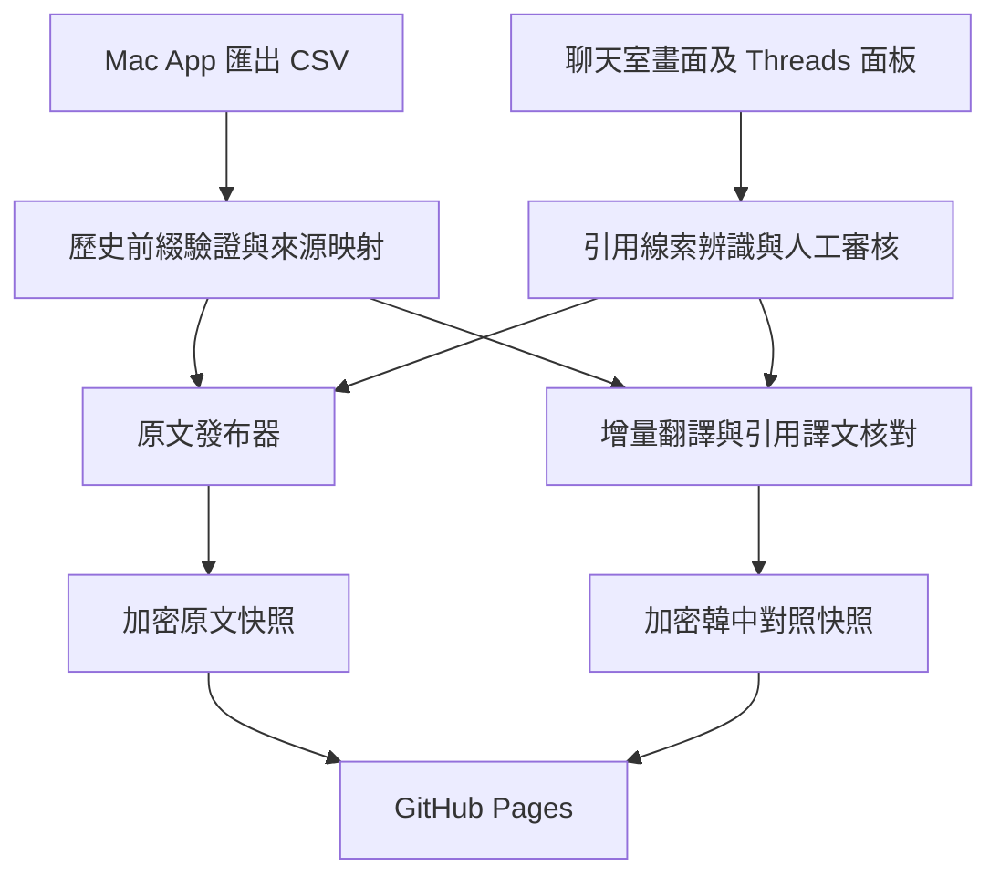

# 現行運作流程（已驗證基準）

更新：2026-11-28。狀態總覽見 [README](../README.md)。本文件描述目前可用的批次流程，不是未來串流架構。

## 1. 整體資料流



正文與回覆資料分開取得；缺少回覆線索不能猜測，正文可先入庫／更新，回覆之後補查。兩個快照各自有進度，不要求同一批同時發布。翻譯版既有批次產出流程曾運作，但 GitHub 目前沒有完整可重跑的翻譯發布腳本，不可聲稱已自動化。

## 2. 現行輸入與限制

- Mac App 內建匯出 CSV：Date、User、Message，限該次匯出的可見與保留範圍，通常秒級時間；另有無日期／暱稱的事件（基準 CSV 42 列）。保存原始檔，不自行修改歷史前綴。CSV 不含原生訊息 ID、引用目標或討論串關係。
- 來源標記：Mac App 匯出、模型／介面掃描衍生表格及 HTML 獨立保存。來源無法追溯的 CSV 標為未知，與有操作證據的 App 匯出分開。見 [來源核對](research/INCREMENTAL-EXTRACTION-REPORT.md#資料來源核對)。
- 回覆：Mac 主聊天畫面辨識引用作者與文字前綴；Threads 面板曾可讀取串內關係。使用者提供的畫面、OCR 或既有已審核線索只在唯一對應時建雙向連結；未知／原文不可載入狀態保留。不得僅因時間接近或語義相似判定為回覆。
- 11/28 歷史掃描：672 份位置辨識結果、52 張舊畫面交叉比對；新增 243 個引文框，其中 137 可定位、106 保留線索。這是歷史增量而非目前全部回覆數；沒有量測完整漏抓率。
- iPhone Gmail ZIP：可取得 TXT，11/28 12:45 匯出共 2,758 行（不是訊息數），已解壓及 CRC32 驗證。中文日期、分鐘時間、作者與正文混排；未見結構化回覆資料。尚不能直接輸入現行發布器；不得補造秒數或覆寫可信 CSV。
- 正文的舊輔助使用介面／OCR 作法及本機檔案位置見 [歷史紀錄](../storage-workflow.md)。未經驗收的自動擷取原型不是正式服務。

## 3. 原文發布器（main 已合併，正式首次遷移未執行）

工作位置為 repo 的 bestie/kakaotalk；使用隔離工作樹與私人資料目錄。先核對 main SHA、既有原文 blob、可信原始 CSV 與快照 export-count。獨立 QA 使用 Node 24.22.3、Python 3.12.14、linkedom 0.18.15；測試時優先重現此版本。不得將金鑰放進命令歷史、環境日誌或 Git。

```sh
node live/test-publish-original.mjs
node live/test-publish-integration.mjs
```

先在測試工作樹用獨立確認的歷史 CSV 產生可信基準。目前原文 export-count 為 2457；若快照已前進，應讀取實際值而非固定套用。

```sh
export TRUSTED_HISTORY_SHA256="$(node live/history-digest.mjs /private/trusted.csv 2457)"
node live/publish-original.mjs /private/current.csv
```

以上發布器從 stdin 讀私有解鎖資訊（操作時以受保護方式輸入並結束 stdin；不要印出或提交）。首次遷移才需可信基準，必須源自已獨立核對的歷史原檔，而不是待測輸入本身。其後單 CSV 模式以快照內的完整前綴雜湊與尾端 anchor 核對歷史，拒絕較短／遭修改的輸入。首次建立（雙 CSV）僅在 original/index.html 不存在時允許，亦須可信 previous 前綴；禁止用舊翻譯快照覆蓋現有原文。

審核配對以私人 JSON 檔經 REVIEWED_PAIRS 環境變數傳入。每組為 [replySelector,targetSelector]；selector 為 [timestamp,name] 或加上正文、1 起算來源列號 [timestamp,name,body,rowNumber]。只接受可唯一定位的較早目標，不可覆寫衝突引用。新舊批次均可定位；重跑不增加重複連結。歷史 ID 不直接由 CSV 列號推算。保留未映射的 137 個歷史一般訊息，未確認不建連結。

## 4. 產出與翻譯

原文保持暱稱、正文、換行、URL、安全事件、頭像與日期時間導航；一般訊息與事件清楚區分。新回覆使用真正 BR 換行；回覆清單放在內容欄。歷史 HTML ID 保持不變，確保舊書籤仍有效。無時間事件保留原樣，不生成虛構日期。

韓中對照沿用原文及既有譯文，只翻新增／缺失部分；引用譯文應取對應原訊息，未載入引用保留狀態。藝人姓名沿用「有智」，暱稱保留原樣。當前翻譯版較舊，需獨立規劃同步及回歸，不以舊翻譯重新初始化現有原文。

## 5. 加密、發布與回退

- 使用原有 AES-256-GCM 金鑰，每次實際更新產生新隨機 12-byte nonce；ciphertext 為密文加 16-byte tag，再 Base64。私鑰僅經私人通道提供，URL fragment 在瀏覽器本機解密，不上傳完整專用 URL。
- 產出先在隔離副本解密驗證：舊 ID、原文、順序、頭像、回覆雙向性、游標、日期跳轉、書籤、手機桌面排版；錯誤金鑰或輸入拒絕時原檔逐位元組不變；重跑無變更不重新加密。
- 合併程式與更新資料快照分成不同 commit。發布前核對 main 及目標 blob，保留上一個穩定版本，禁止強制覆寫不明更新。一次只允許一個發布工作；目前尚無完整並行發布鎖。
- GitHub Pages 只提交加密 HTML 與無私人資料的程式／文件。核對部署成功後再以原私人連結測試實際閱讀器，注意快取及 fragment 保留。若失敗，以經授權的獨立回退 commit 恢復上一版相應檔案，不抹除 Git 歷史。
- QA 依據：[第一輪](../live/QA-REPORT.md)、[第二輪](../live/QA-REPORT-ROUND2.md)。Safari 實機、並行發布、強制終止及遠端部署故障仍未驗收。QA 副本中的新增紀錄不可上線。
