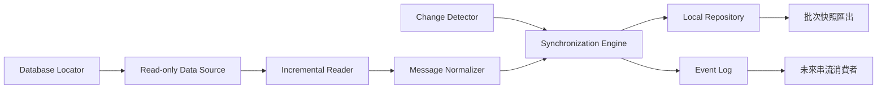

# 第二代 KakaoTalk 原生擷取器設計

2026-11-28（台灣時間）。批次產出與未來事件消費者共用同一條本機同步流程。第一個交付是旁路資料庫及可重跑的本機同步，驗收後再接現有發布流程。[選型與實測](INCREMENTAL-EXTRACTION-REPORT.md)

| 模組 | 職責 |
| --- | --- |
| Database Locator | 初次透過已授權的識別方式定位，確認房間唯一。向 OS Keychain 讀取可撤銷的本機解鎖資料是後續提案，須驗證存取控制與失效流程。非秘密設定可保存在使用者專屬目錄。啟動只重驗檔案身分、App 版本、解密、必要欄位與目標房間。失配時停用舊配置並回報，避免自動反覆執行昂貴定位。 |
| Read-only Data Source | 提供一次來源世代及一個短快照。用唯讀旗標加 query_only，預設穩定副本。直接連線需環境驗收，現有 WAL 與 SHM 可安全共用時才採用。App 結束、路徑或 inode／schema 改變、檔案未就緒、加密拒絕時關閉舊 handle。暫時忙碌採有限重試，等待後仍失敗則保留進度並改用一致副本。 |
| Change Detector | 資料庫目錄、主檔、WAL 的共用世代追蹤。debounce 合併突發通知，處理 rename／delete／重建後重綁；輪詢、程序啟動及休眠喚醒都觸發補抓。同一連線 data_version 只作提示，無通知仍須週期核對。 |
| Incremental Reader | 同一房間用參數化 SQL，以已提交高水位讀新 ID，用有索引的近期 ID 重疊與輪替檢查舊頁補抓變更。持續寫入時給每批固定上界，分頁交易短且讀完釋放。保留原始 msgId 並偵測同房間 logId 不唯一；若出現同 ID 多列，先停止推進並驗證複合游標與身分定義。查詢及比較使用 SQLite 整數或無損 BigInt，跨模組以字串保存。 |
| Message Normalizer | 保存原生正文、時間與精度、type／status／scope／revision、引用觀察、Thread 關係和來源版本。原生引用與已有翻譯獨立存放。依房間 linkId 讀作者識別與暱稱。未知代碼可入庫，UI 顯示判斷須另經驗證。 |
| Synchronization Engine | 單房間單工作、有限併發。從已提交游標及重疊區讀取，原生 ID 去重並比較有版本的欄位指紋。以有限時間做對帳，區分新訊息、舊訊息變更、目標不可見及來源尚未觀察到，禁止因單次查無資料就抹除舊紀錄。 |
| Local Repository | 旁路資料庫保留原生、App 匯出、畫面衍生和未知來源。使用穩定內部 ID，原生映射與舊網頁 ID 另存。僅在唯一證據時遷移翻譯與書籤。保留原有缺失歷史及證據，不因投影更新併掉不同來源。 |
| Event Log | 和訊息／討論串狀態、已提交游標在同一本機交易持久化。事件序號由本機資料庫產生，獨立於 Kakao 原生 ID，供未來重連按序重播。 |

## 增量與對帳

從固定房間和一致快照取得上界與最多一頁記錄。完成本機更新後才提交游標。每頁重新開始短來源交易，因此整輪並非單一長交易；上界內後續補入的較舊 ID 交由重疊及對帳處理。碰到來源世代改變、頁面不一致或驗證失敗，丟棄尚未入庫的批次，保留上次提交點。重啟先從提交點加重疊。任何按時間做的對帳須包含同秒資料，避免只用 sentAt 作斷點。

用按 (chatId, logId) 分段的投影指紋或逐列差異找出較舊變更，保留查驗進度及來源範圍。近期同時檢查 type、status、revision、scope、引用和正文。討論串依房間與 threadId 比對成員、串尾與計數，保留成員表未註冊之串。作者以房間及作者 ID 做獨立比較，更新暱稱不等於改寫歷史訊息。週期高水位查詢捕捉新列，對帳負責最終收斂；兩者會有不同延遲上限，需實測後設定。發現新欄位或版本時先停用有疑義的語義映射。

## 事件與批次共用契約

事件最小欄位為本機 seq、schemaVersion、事件類型、房間識別、內部物件 ID、來源版本、變更觀察時間及可選原因。事件 payload 只放需要的差異。原生 ID 用十進位字串。不把原始金鑰或已撤回內容放進事件。事件保留期與私有存取等到串流階段決定。

- `message.created` 和 `message.updated` 可由首次觀察及指紋變動產生；首次匯入需明確標示為歷史補錄。
- `message.retracted` 只在原生事件與 App 呈現語義已驗證時啟用。未驗證時保存狀態代碼和來源事件。
- `thread.updated` 反映成員、串尾或來源計數變更，`author.updated` 反映同房間作者的顯示資料變更。
- `translation.completed` 是本機翻譯工作結果，引用當時的原文版本，避免覆蓋後續編輯。

批次發布讀本機資料庫的一致快照及其事件序號。未來消費者沿用該序號，先取快照，再重播其後事件；事件已超出保留期時重新取快照。擷取與翻譯寫其本機交易，批次發布和串流都無須直接讀 KakaoTalk 或重新擷取。本階段未建立遠端服務。

## 驗收順序

1. 穩定副本環境通過同秒、低 ID 補載、早期撤回、身份變動、討論串及舊書籤兼容測試。
2. 實際 App 自然寫入中驗證來源狀態、唯讀開啟與復原，量測空輪詢、檔案事件、端到端延遲及多日資源。
3. 確認同一交易原子提交，驗證重跑、斷電恢復、老資料對帳及映射歧義，保留回退到現有流程的能力。完成驗收再由擁有者決定切換。
